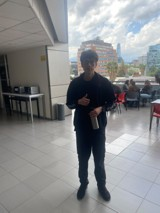
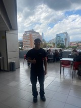
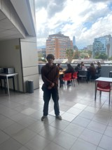
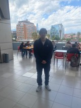

# S10 - Ejercicio de observación y selección de la solución

**Fecha:** 22-10-2026  
**Participantes:** Matías Sandoval, Javier Saavedra, Sebastian Sepulveda, Franco Rodriguez  
**Responsable del registro:** Matias Sandoval

## Objetivo
Entrenar la observación antes de interpretar mediante el ejercicio de la Clase 5, distinguiendo hechos de supuestos, y aplicar esa misma lógica a una afirmación de nuestro proyecto. En paralelo, avanzar en la selección de la solución para el Hub Providencia.

## Actividades realizadas
1. Retomamos las clases después de tres semanas de paro (S07 a S09).
2. Realizamos el ejercicio de observación grupal en la terraza del quinto piso de la universidad, sector de mesas y sillas, entre las 15:00 y las 15:10. No interactuamos con las personas y cada integrante tomó una fotografía al finalizar.
3. Cada integrante observó el espacio con una lente distinta:

| Integrante | Lente asignada |
|---|---|
| Sebastián Sepúlveda | 1. Flujos, tiempos y uso del espacio |
| Franco Rodríguez | 2. Conductas e interacciones |
| Matías Sandoval | 3. Espacio e infraestructura |
| Javier Saavedra | 4. Información, objetos y tecnología |

4. Cruzamos las cuatro miradas para completar las partes grupales de la ficha: comportamiento inesperado, síntesis del equipo y conexión con el proyecto Capstone.
5. Cuestionamos una afirmación de nuestro proyecto con la lógica del ejercicio (parte 6 de la ficha).
6. Evaluamos las 10 ideas de solución con una matriz de cuatro criterios: evidencia que la respalda, impacto en el equipo de gestión, factibilidad en el semestre y costo.
7. Evaluamos la factibilidad de medir el peso de los cajones de PLA con celdas de carga y un ESP32.

## Evidencias

- [Ficha de observación completa del equipo](../entregas/ficha-observacion-revirt.pdf)
- [Propuesta de solución Revirt Traza](../entregas/propuesta-solucion-revirt.md)

## Resultados

**Hechos respaldados por la observación**
- Había entre 6 y 10 personas en el sector a las 15:00, con ocupación parcial: varias mesas tenían espacios libres.
- Las actividades predominantes fueron comer y descansar; también se registró estudio con computador.
- Los dos microondas se usaron con frecuencia para calentar comida a esa hora.
- La mayoría estaba acompañada o en grupos y portaba mochila o bolso.
- Varias personas se apoyaron en la baranda para mirar la vista de Santiago.

**Lo que contradijo lo que esperábamos**
- Esperábamos ver solo grupos, pero había estudiantes solitarios usando el espacio.
- Un grupo usó la terraza, pensada para comer y circular, como zona de estudio en torno a un computador.

**Conexión con el proyecto**
- Tratábamos como un hecho que «el residuo principal del Hub es el PLA de impresión 3D». Al aplicar la lógica del ejercicio concluimos que es un **supuesto basado en un testimonio**: lo dijo el personal del Hub, pero nunca lo hemos medido ni comparado con los demás residuos.
- Para comprobarlo necesitamos pesar cada tipo de residuo durante 2 semanas. Ese registro coincide con el piloto de nuestra propuesta.

**Selección de la solución**
- Las ideas mejor evaluadas fueron el registro con QR en el origen (19 puntos), el registro rápido de la salida (18) y el reporte automático (17).
- La balanza con ESP32 subió a 17 puntos porque la universidad nos puede prestar los ESP32; solo debemos comprar las celdas de carga (aprox. $14.000 a $21.000 CLP por cajón).

## Decisiones y justificación

| Decisión | Evidencia o criterio | Consecuencia para el proyecto |
|---|---|---|
| Asignar una lente distinta a cada integrante | Instrucción del ejercicio; al principio no lo entendimos y todos observamos varias lentes a la vez | Las cuatro miradas cubrieron más aspectos del espacio sin repetirse |
| Clasificar la afirmación «el PLA es el residuo principal» como supuesto | Solo tenemos el testimonio del Hub y una foto de los cajones; no hay pesos ni volúmenes | El piloto debe medir todos los tipos de residuo, no solo el PLA |
| Combinar QR, registro de salida y reporte automático en la solución Revirt Traza | Fueron las ideas con mayor puntaje en la matriz y responden a la falta de seguimiento observada en S06 | La propuesta del pitch se construye sobre estas tres ideas |
| Usar celdas de carga en los cajones de PLA en vez de un sensor ultrasónico | La Municipalidad pide kilos; el ultrasónico mide volumen y los restos de PLA tienen formas irregulares | Hay que comprar un kit de 4 celdas y un módulo HX711 por cajón |

## Errores, dificultades o riesgos
- **Qué no funcionó:** al principio cada integrante registró varias lentes, cuando el ejercicio pedía una por persona. También, en algunos registros mezclamos hechos con interpretaciones; por ejemplo, escribimos «espera de su siguiente clase» como hecho, aunque no es algo que se pueda ver.
- **Por qué creemos que ocurrió:** leímos rápido las instrucciones y todavía nos cuesta separar lo que vemos de lo que suponemos.
- **Qué haremos para comprobarlo o corregirlo:** revisar cada afirmación con una pregunta simple: «¿esto lo vi, lo conté o lo deduje?». La usaremos también en las próximas visitas al Hub.

- **Riesgo identificado:** la balanza con sensores depende de que haya Wi-Fi, un enchufe cerca de los cajones y permiso del Hub para instalarla.
- **Mitigación:** confirmar esos tres puntos en la próxima visita antes de comprar las celdas de carga.

## Aprendizajes
- Diez minutos de observación entregan hechos concretos, pero no explican por qué ocurren. Por ejemplo, vimos personas compartiendo mesa, pero no podemos saber si se conocen.
- Mirar con una sola lente obliga a fijarse en detalles que de otra forma se pasan por alto, como el letrero del ascensor o la forma de romboide de la terraza.
- Nuestro proyecto también tiene afirmaciones que tratamos como hechos sin haberlas medido. El mismo método del ejercicio sirve para detectarlas.

## Tareas y responsables

| Tarea | Responsable(s) | Fecha límite | Estado |
|---|---|---|---|
| Entregar la ficha de observación grupal | Todos | 22-10-2026 | Completado |
| Subir las fotos de la observación a `/imagenes/S10/` y la ficha a `/entregas/` | Matías Sandoval | 29-10-2026 | Pendiente |
| Preparar el pitch de la solución | Todos | 29-10-2026 | En progreso |
| Confirmar con el Hub el Wi-Fi, un enchufe cerca de los cajones y el permiso para instalar la balanza | Javier Saavedra | 29-10-2026 | Pendiente |
| Cotizar el kit de celdas de carga y el módulo HX711 | Sebastian Sepulveda | 29-10-2026 | Pendiente |

## Próximo paso
Presentar el pitch de la solución Revirt Traza. Sabremos que resultó si el pitch muestra la evidencia de terreno, explica los tres pasos de la solución y declara qué supuestos siguen pendientes de validar.

## Fuentes consultadas
- Universidad Mayor (2026). *Ficha de observación, Clase 5*. Capstone Intermedio.
- Equipo Revirt (2026). Bitácora S06: visita a terreno al Hub Providencia.
- Equipo Revirt (2026). Propuesta de solución Revirt Traza.
