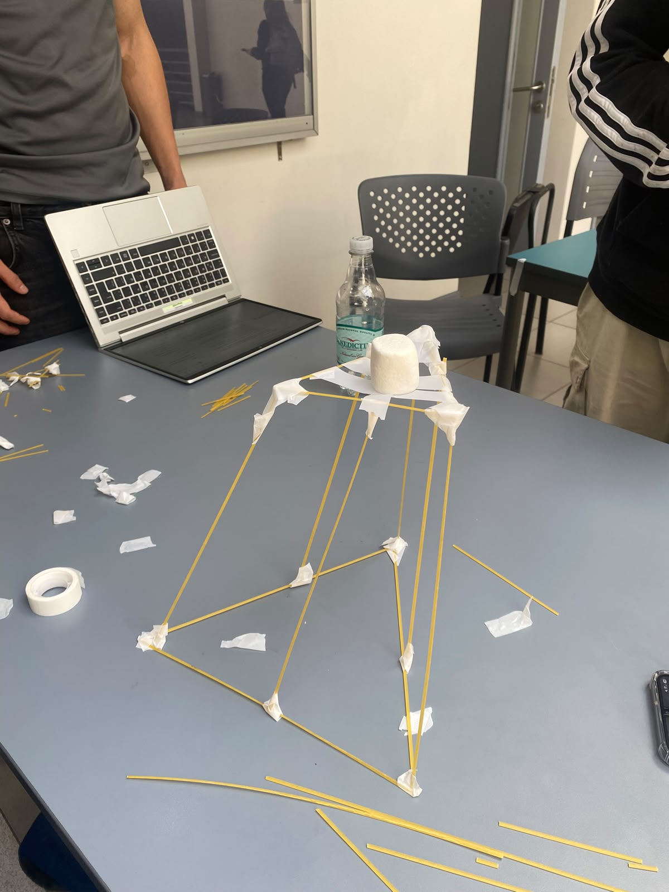
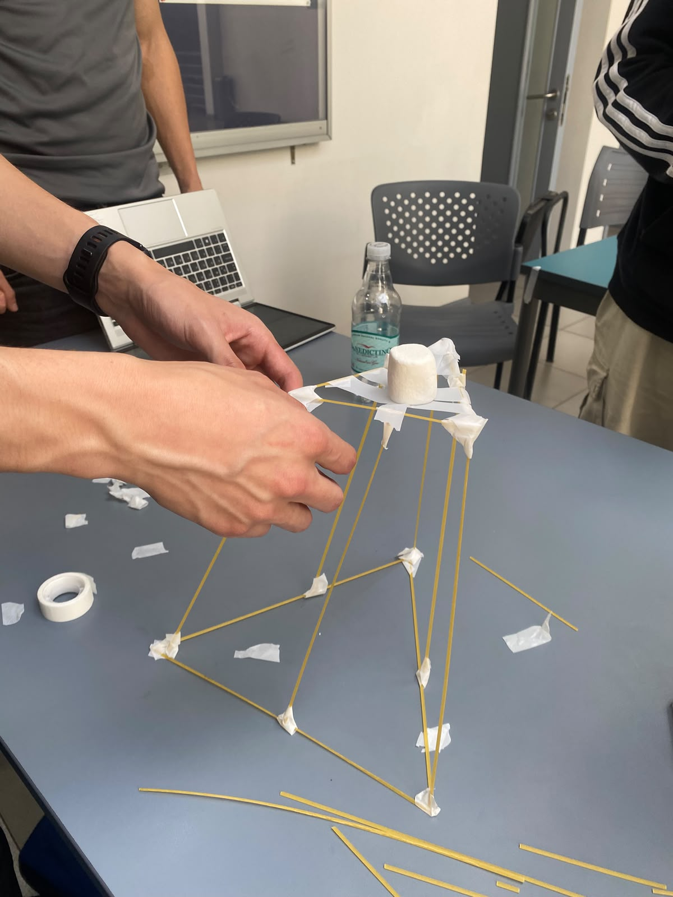
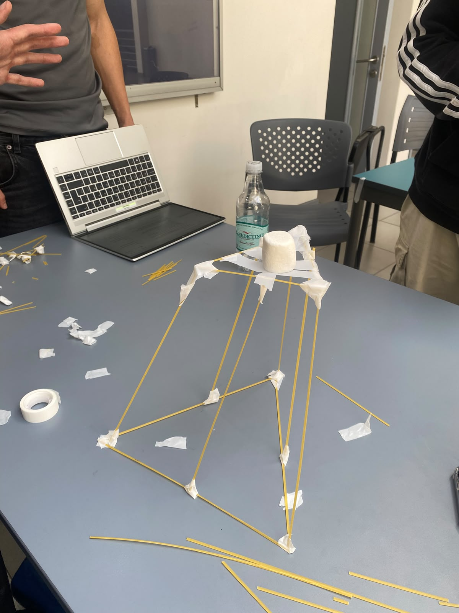

# S12 - Desafío de la torre de fideos y pitch de Revirt Traza

**Fecha:** 05-11-2026  
**Participantes:** Matías Sandoval, Javier Saavedra, Sebastian Sepulveda, Franco Rodriguez  
**Responsable del registro:** Matias Sandoval

## Objetivo
Practicar el prototipado rápido con materiales limitados mediante el desafío de la torre de fideos, y presentar el pitch de la solución Revirt Traza, reagendado desde la clase suspendida del 29-10-2026.

## Actividades realizadas
1. Recibimos los materiales del desafío: 15 fideos y 1 metro de cinta adhesiva.
2. Construimos una torre de fideos en 1 minuto, el tiempo máximo que dio la docente.
3. Comparamos nuestra torre con las de los otros equipos y comentamos qué estructuras se mantuvieron más estables.
4. Presentamos el pitch «Revirt Traza: pesaje con sensores», con la solución basada solo en celdas de carga y un ESP32 bajo el cajón de PLA.

## Evidencias

- Presentación del pitch «Revirt Traza: pesaje con sensores».

## Resultados
- La torre se construyó dentro del minuto disponible con los 15 fideos y la cinta.
- No medimos la altura que alcanzó la torre, por lo que no podemos compararla con un valor exacto.
- Usamos los fideos enteros. Al ser largos y delgados, se doblaban y la estructura quedaba inestable.
- El pitch presentó el problema de la falta de datos de PLA, la estación de pesaje y los pasos para el piloto con un solo cajón.

## Decisiones y justificación

| Decisión | Evidencia o criterio | Consecuencia para el proyecto |
|---|---|---|
| Usar los fideos enteros para ganar altura | Con 1 minuto no alcanzamos a planificar otra forma | La torre quedó alta, pero poco estable |
| Presentar la solución solo con sensores de peso, sin QR | La Municipalidad necesita kilos y el kit del curso incluye el ESP32 | El prototipo se concentra en la celda de carga, el HX711 y el ESP32 |

## Errores, dificultades o riesgos
- **Qué no funcionó:** la torre fue inestable porque los fideos largos se doblaban con poco peso. No medimos la altura final.
- **Por qué creemos que ocurrió:** con solo 1 minuto empezamos a construir sin acordar un diseño, y nadie quedó a cargo de registrar el resultado.
- **Qué haremos para comprobarlo o corregirlo:** si lo hiciéramos de nuevo, cortaríamos los fideos en trozos más cortos para formar una base triangular más estable. En las próximas pruebas, un integrante quedará encargado de medir y registrar cada resultado.

- **Riesgo identificado:** en el prototipo de Revirt Traza puede pasar lo mismo si la plataforma de la balanza queda inestable; por ejemplo, una base que se mueve daría lecturas de peso erróneas.
- **Mitigación:** diseñar una plataforma firme y probarla con pesos conocidos antes de instalarla.

## Aprendizajes
- Con poco tiempo y pocos materiales, la estabilidad importa más que la altura. Un trozo corto de fideo resiste más que uno largo.
- Medir y registrar el resultado es parte de la prueba. Sin la altura de la torre, no podemos decir cuánto mejoraríamos con otro diseño.
- La misma lógica aplica a nuestro proyecto: el prototipo de la balanza debe probarse con datos medidos, por ejemplo con botellas de agua de peso conocido.

## Tareas y responsables

| Tarea | Responsable(s) | Fecha límite | Estado |
|---|---|---|---|
| Presentar el pitch de Revirt Traza | Todos | 05-11-2026 | Completado |
| Simular el circuito de la balanza en Wokwi (ESP32, HX711, LCD y botón) | Matías Sandoval | 12-11-2026 | Completado |
| Preparar la presentación de avance del prototipo | Todos | 12-11-2026 | Completado |
| Subir las fotos de la torre de fideos a `/imagenes/S12/` | Matías Sandoval | 12-11-2026 | Completado |

## Próximo paso
Presentar el avance del prototipo de Revirt Traza. Sabremos que resultó si la simulación muestra la tara, la calibración y una medición de peso con un error menor al 5 %.

## Fuentes consultadas
- Universidad Mayor (2026). *Desafío de la torre de fideos*. Capstone Intermedio.
- Equipo Revirt (2026). Pitch «Revirt Traza: pesaje con sensores».
- Equipo Revirt (2026). Bitácora S11: suspensión de la sesión por la docente.
