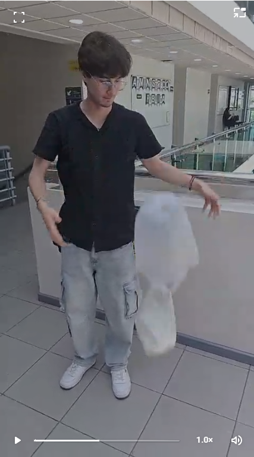

# S13 - Desafío del huevo y presentación del prototipo

**Fecha:** 12-11-2026  
**Participantes:** Matías Sandoval, Javier Saavedra, Sebastian Sepulveda, Franco Rodriguez  
**Responsable del registro:** Matias Sandoval

## Objetivo
Diseñar un dispositivo que proteja un huevo en una caída controlada, como ejercicio de prototipado, y presentar el avance del prototipo de Revirt Traza.

## Actividades realizadas
1. Diseñamos un dispositivo para proteger un huevo con tres materiales: papel, una caja de plumavit y bolsas plásticas.
2. Pusimos el huevo dentro de la caja de plumavit, lo rodeamos con papel para amortiguar el golpe y amarramos bolsas plásticas para frenar la caída como un paracaídas.
3. Soltamos el dispositivo desde una altura aproximada de 1,5 metros.
4. Presentamos el avance del prototipo de Revirt Traza: la simulación en Wokwi de la estación de pesaje con ESP32, celda de carga, HX711, pantalla LCD y botón.
5. Recibimos los comentarios de la docente sobre el prototipo.

## Evidencias

- Presentación «Revirt – Avance por equipo» con las capturas de la simulación en Wokwi.

## Resultados
- **El huevo sobrevivió** a la caída de aproximadamente 1,5 metros.
- El dispositivo combinó dos formas de protección: el papel y el plumavit absorbieron el golpe, y las bolsas redujeron la velocidad de caída.
- En la simulación de Revirt Traza, la balanza calibrada midió 2,19 kg y 4,07 kg con un error menor al 0,1 %.
- La docente comentó que el prototipo está bien, pero que debemos construirlo físicamente para la próxima semana.

## Decisiones y justificación

| Decisión | Evidencia o criterio | Consecuencia para el proyecto |
|---|---|---|
| Combinar amortiguación (papel y plumavit) con freno (bolsas) | Una sola protección podía fallar; por ejemplo, la caja sola no frena la caída | El huevo llegó entero al suelo |
| Construir el prototipo físico de Revirt Traza la próxima semana | Comentario de la docente: la simulación está bien, pero falta el prototipo real | Hay que comprar la celda de carga y el HX711 de inmediato |

## Errores, dificultades o riesgos
- **Qué no funcionó:** hicimos una sola prueba de caída, así que no sabemos si el dispositivo resiste siempre o si tuvimos suerte. Tampoco medimos la altura exacta.
- **Por qué creemos que ocurrió:** el tiempo de la actividad era corto y nos concentramos en construir el dispositivo.
- **Qué haremos para comprobarlo o corregirlo:** en las pruebas de la balanza repetiremos cada medición 10 veces, para no sacar conclusiones de un solo intento.

- **Riesgo identificado:** la simulación no tiene ruido eléctrico ni problemas mecánicos, por lo que el prototipo físico puede medir con más error que en Wokwi.
- **Mitigación:** probar el prototipo con pesos conocidos de 0,5, 1 y 2 kg y recalibrar si el error supera el 5 %.

## Aprendizajes
- Un prototipo rápido con materiales simples sirve para probar una idea. Con papel, plumavit y bolsas logramos proteger el huevo.
- Funcionar una vez no es lo mismo que funcionar siempre. Para confiar en un resultado hay que repetir la prueba.
- Una simulación ayuda a desarrollar el código, pero no reemplaza el prototipo real. Por ejemplo, en Wokwi el peso es exacto, mientras que una celda real tiene ruido y deriva.

## Tareas y responsables

| Tarea | Responsable(s) | Fecha límite | Estado |
|---|---|---|---|
| Presentar el avance del prototipo de Revirt Traza | Todos | 12-11-2026 | Completado |
| Comprar la celda de carga de 5 kg y el módulo HX711 | Franco Rodriguez | 18-11-2026 | Pendiente |
| Armar el prototipo físico y cargar el código probado en Wokwi | Sebastian Sepulveda | 19-11-2026 | Pendiente |
| Probar la precisión con pesos conocidos (10 repeticiones por peso) | Javier Saavedra | 22-11-2026 | Pendiente |
| Completar el informe de avance | Todos | 19-11-2026 | En progreso |
| Subir la foto del desafío del huevo a `/imagenes/S13/` | Matías Sandoval | 19-11-2026 | Completado |

## Próximo paso
Presentar el prototipo físico de Revirt Traza funcionando. Sabremos que resultó si la balanza real mide pesos conocidos con un error menor al 5 %.

## Fuentes consultadas
- Universidad Mayor (2026). *Desafío: dispositivo para proteger un huevo en una caída controlada*. Capstone Intermedio.
- Equipo Revirt (2026). Presentación «Revirt – Avance por equipo».
- Equipo Revirt (2026). Bitácora S12: desafío de la torre de fideos y pitch de Revirt Traza.
